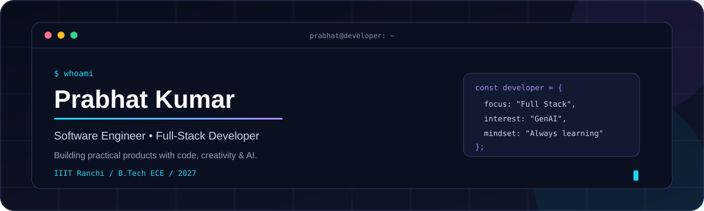

<picture>
  <source media="(prefers-color-scheme: dark)" srcset="dark.svg">
  <source media="(prefers-color-scheme: light)" srcset="light.svg">
  
</picture>

<h2 align="center">Hey there! I'm Prabhat Kumar 👋</h2>

  <strong>Software Engineer | Full-Stack Developer | AI Enthusiast</strong>

  
  
  

---

## `$ whoami`

I'm a Computer Science and Engineering enthusiast pursuing **B.Tech in Electronics and Communication Engineering at IIIT Ranchi (2023–2027)**.

I enjoy building practical software products, developing scalable backend systems, and exploring how Generative AI can solve real-world problems.

- 🎓 B.Tech ECE — IIIT Ranchi
- 💻 Full-Stack Development & Backend Engineering
- 🤖 Exploring LLM APIs, RAG and AI-powered applications
- 🧩 Interested in Data Structures, Algorithms and System Design
- 🚀 Always learning, building and improving

---

## `$ tech_stack`

### Languages

  

### Frontend

  

### Backend & Databases

  

### Tools & Technologies

  

**AI & GenAI:** LLM APIs · RAG (Basics) · Prompt Engineering · AI Agents (Basics)

---

## `$ experience`

### Full Stack Developer Intern — Sociolinq Technologies
**December 2025 – October 2026**

- Worked on an Employee Conversion Management System using React and FastAPI.
- Integrated frontend components with REST APIs.
- Implemented role-based access control and workflow validation.
- Contributed to a multi-stage approval workflow involving managers, HR and finance.
- Worked with approval state tracking and audit logs.

---

## `$ featured_projects`

### 1. PKAI — AI-Powered SaaS Platform
**React · Express.js · PostgreSQL · Clerk · Gemini API**

- Built an AI-powered platform featuring article generation and resume analysis.
- Integrated AI image generation and image editing capabilities.
- Implemented authentication and role-based access control.
- Explored retrieval-based resume analysis using embeddings and vector similarity.

🔗 [Live Demo](https://pkai-umber.vercel.app/ai/write-article)

### 2. Pingy — Real-Time Chat Application
**React · Node.js · Express.js · MongoDB · Socket.IO**

- Developed a real-time messaging application.
- Implemented JWT-based authentication.
- Integrated Socket.IO for real-time communication.
- Used Cloudinary for media handling.

🔗 [Live Demo](https://chat-app-beryl-one-46.vercel.app)

### 3. Lendwise — Learning Management System
**Next.js · TypeScript · Tailwind CSS · Express.js · MongoDB**

- Developed a full-stack learning management platform.
- Implemented authentication and role-based access control.
- Worked with backend APIs and file upload functionality.

---

## `$ achievements`

- 🏆 Secured **2nd Position** in Space Day Hackathon 2024.
- ⚔️ **LeetCode Knight** — Maximum Rating: 1888.
- 🏅 **Codeforces Specialist** — Maximum Rating: 1485.
- 💡 Solved **450+ DSA problems** on GeeksforGeeks.

---

## `$ currently_focusing_on`

- Strengthening Data Structures & Algorithms.
- Building production-oriented full-stack applications.
- Learning backend architecture and system design fundamentals.
- Exploring Generative AI, RAG and AI-powered workflows.

---

## `$ connect`

  <a href="mailto:pk0275243@gmail.com">Email</a> •
  <a href="https://www.linkedin.com/in/prabhat-kumar-8861b7314">LinkedIn</a> •
  <a href="https://github.com/prabhatK0812">GitHub</a>

  <i>"Build consistently. Learn continuously. Improve every day."</i>

